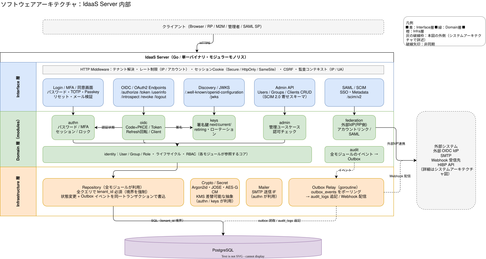

# ソフトウェアアーキテクチャ

IdaaS Server（Go / 単一バイナリ・モジュラーモノリス）の内部構造を表す。
外部との連携は [システムアーキテクチャ](../system/README.md)を参照。

## 層

| 層 | 責務 |
|---|---|
| Interface | HTTP の入口。Middleware（テナント解決・レート制限・セッション Cookie・CSRF・監査コンテキスト）と各エンドポイント |
| Domain | ユースケースとドメインロジック。モジュール単位に分割する |
| Infrastructure | 永続化・暗号・メール送信・Outbox Relay など外部資源へのアクセス |

## モジュール

| モジュール | 責務 |
|---|---|
| `identity` | ユーザー・グループ・ロール、ライフサイクル、RBAC。各モジュールが参照するコア |
| `authn` | パスワード・MFA・セッション・アカウントロック |
| `oidc` | OP のプロトコル処理（Code + PKCE、トークン、リフレッシュのローテーション、クライアント） |
| `keys` | 署名鍵（next / current / retiring）とローテーション、JWKS |
| `federation` | 外部 IdP 連携（RP 側）、アカウントリンク、SAML |
| `admin` | 管理ユースケースと認可チェック |
| `audit` | ドメインイベントの定義と Outbox への書き込み |

## DB 設計

PostgreSQL のテーブル設計。ER 図はモジュールごとに分ける。

### 共通ルール

| ルール | 内容 |
|---|---|
| テナント境界 | すべてのテーブルに `tenant_id` を持たせる（`tenants` を除く）。テナントをまたぐ参照は `(tenant_id, id)` の複合外部キーで DB レベルでも禁止する |
| 一意制約 | ログイン ID・メールアドレス・`client_id` などの一意性はテナント単位（`UK(tenant_id, ...)`）で保証する |
| 秘密情報 | トークン・コード・クライアントシークレット・リカバリーコードは**ハッシュ**で保存する（`*_hash`）。復号が必要なもの（TOTP シード・署名鍵の秘密鍵・外部 IdP のクライアントシークレット・Webhook シークレット）は**暗号化**して保存し、暗号鍵の識別子（`encryption_key_id`）を併せて持つ |
| パスワード | Argon2id の PHC 文字列（アルゴリズムとパラメータを含む）で保存し、ログイン時にパラメータが古ければ再ハッシュする |
| 削除 | ユーザーは `deleted_at` による論理削除と、物理削除の両方に対応する |
| 状態とイベント | 状態変更と `outbox_events` への追加は同一トランザクションで行う |
| 監査ログ | `audit_logs` は追記のみ（更新・削除はトリガーで拒否）。`prev_hash` / `hash` のハッシュ連鎖で改ざんを検知できるようにする |

### モジュール別のテーブル

| モジュール | 対象 | ER 図 |
|---|---|---|
| `identity` | ユーザー・グループ・ロール | [identity](database/identity.md) |
| `authn` | パスワード・MFA・セッション・ワンタイムトークン | [authn](database/authn.md) |
| `oidc` | クライアント・認可コード・トークン・同意 | [oidc](database/oidc.md) |
| `federation` | 外部 IdP・SAML SP・SAML IdP の署名鍵 | [federation](database/federation.md) |
| `keys` / `audit` | 署名鍵・Outbox・監査ログ・Webhook | [keys-audit](database/keys-audit.md) |
