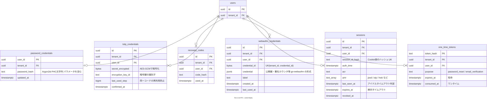

# DB 設計：authn（資格情報・セッション）

パスワード・MFA（TOTP・リカバリーコード・WebAuthn）・IdP セッション・ワンタイムトークン（パスワードリセット・メール検証）。

共通ルール（テナント境界・秘密情報の保存方法など）は [ソフトウェアアーキテクチャ](../README.md#db-設計) を参照。

---

← [前: identity](identity.md) ｜ [テーブル一覧](../README.md#db-設計) ｜ [次: oidc](oidc.md) →
