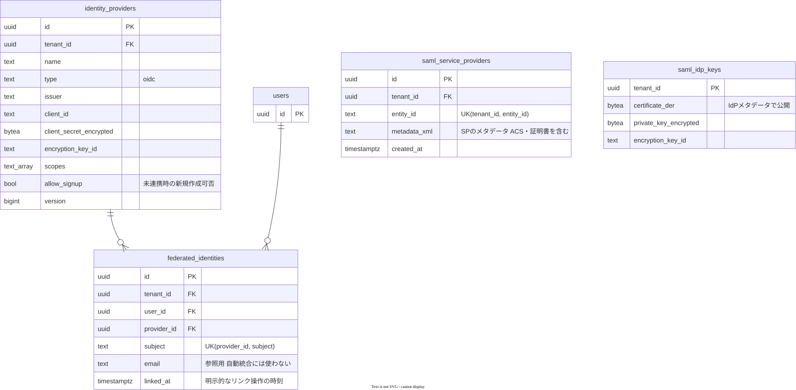

# DB 設計：federation（外部 IdP・SAML SP）

外部 IdP のアカウントは `(provider_id, subject)` で識別する。`federated_identities.email` は参照用で、メールアドレスの一致だけでアカウントを自動統合しない。SAML SP は登録時のメタデータ XML で管理し、IdP の署名鍵と証明書はテナントごとに `saml_idp_keys` に暗号化して保存する。

共通ルール（テナント境界・秘密情報の保存方法など）は [ソフトウェアアーキテクチャ](../README.md#db-設計) を参照。

---

← [前: oidc](oidc.md) ｜ [テーブル一覧](../README.md#db-設計) ｜ [次: keys-audit](keys-audit.md) →
