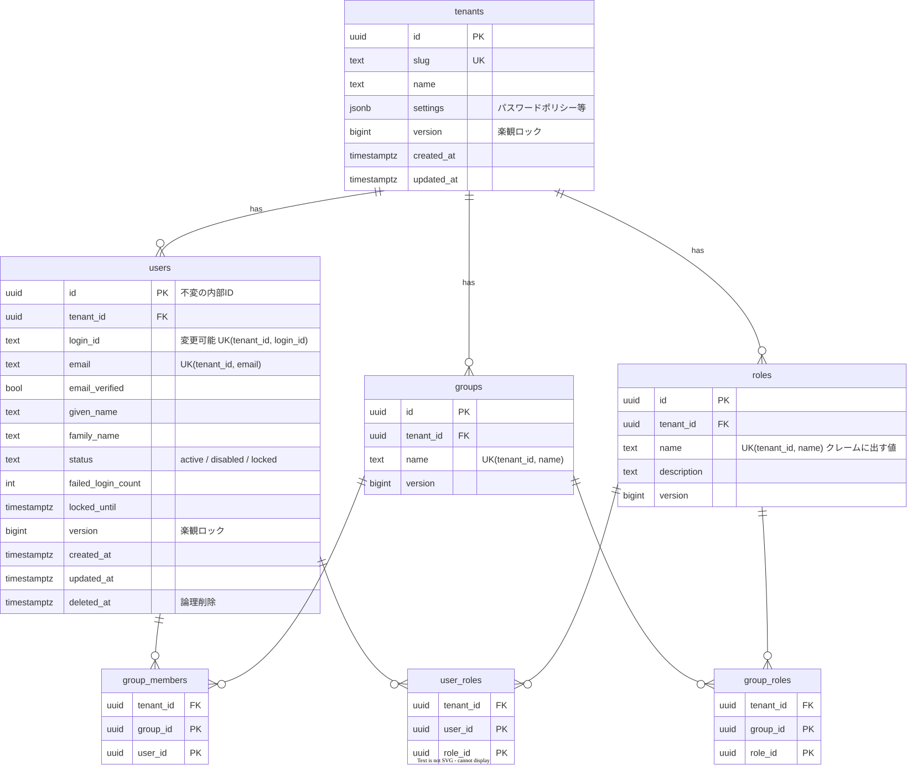

# DB 設計：identity（ユーザー・グループ・ロール）

内部 ID（`users.id`、不変）とログイン ID（`users.login_id`、変更可能）を分ける。ロールはユーザーに直接、またはグループ経由で割り当てる。

共通ルール（テナント境界・秘密情報の保存方法など）は [ソフトウェアアーキテクチャ](../README.md#db-設計) を参照。

---

[テーブル一覧](../README.md#db-設計) ｜ [次: authn](authn.md) →
