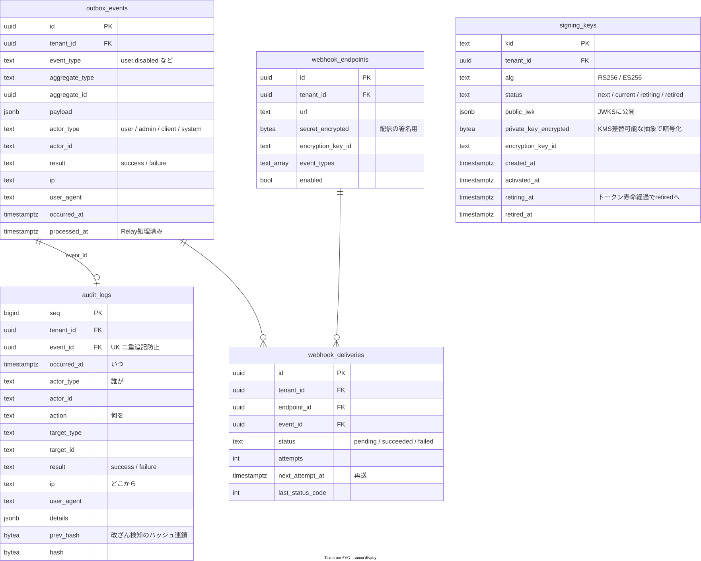

# DB 設計：keys / audit（署名鍵・Outbox・監査ログ・Webhook）

署名鍵は `status`（next / current / retiring / retired）で並行運用する。Outbox Relay が `outbox_events` を処理して `audit_logs` に追記し、`webhook_deliveries` で配信と再送を管理する。

共通ルール（テナント境界・秘密情報の保存方法など）は [ソフトウェアアーキテクチャ](../README.md#db-設計) を参照。

---

← [前: federation](federation.md) ｜ [テーブル一覧](../README.md#db-設計)
