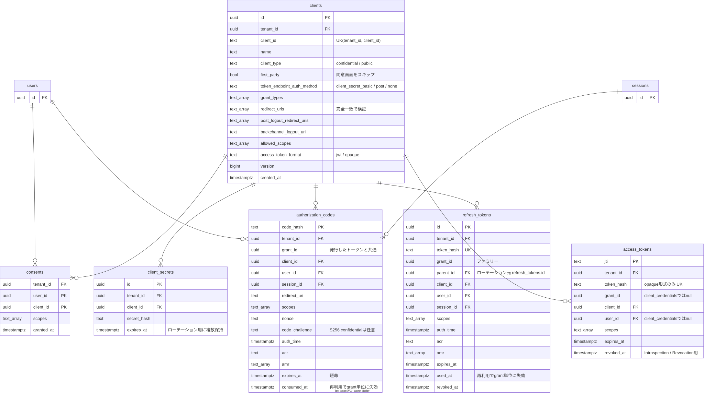

# DB 設計：oidc（クライアント・認可コード・トークン）

認可コード・リフレッシュトークン・アクセストークンは `grant_id` で結び付ける。認可コードやリフレッシュトークンの再利用を検知したら、同じ `grant_id` のトークンをまとめて失効させる。

共通ルール（テナント境界・秘密情報の保存方法など）は [ソフトウェアアーキテクチャ](../README.md#db-設計) を参照。

---

← [前: authn](authn.md) ｜ [テーブル一覧](../README.md#db-設計) ｜ [次: federation](federation.md) →
