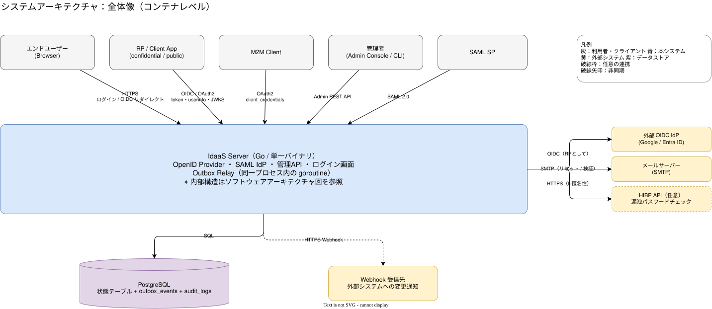

# システムアーキテクチャ

IdaaS Server を 1 つのコンポーネントとして扱い、利用者・外部システム・データストアとの連携を表す。
IdaaS Server の内部構造は [ソフトウェアアーキテクチャ](../software/README.md)、外部に公開する API の詳細は [API 仕様](../../../api/openapi/README.md) を参照。

## 全体像

| コンポーネント | 役割 |
|---|---|
| IdaaS Server | OpenID Provider・SAML IdP・管理 API・ログイン画面を提供する単一バイナリ。Outbox Relay を同一プロセス内の goroutine として持つ |
| PostgreSQL | 状態テーブル、`outbox_events`、`audit_logs` を保持する |
| 外部 OIDC IdP | 外部 IdP 連携時のログイン先（IdaaS Server は RP として振る舞う） |
| メールサーバー（SMTP） | パスワードリセット・メール検証のメール送信 |
| HIBP API（任意） | 漏洩パスワードのチェック |
| Webhook 受信先 | 変更イベントの通知先 |

## 主要フロー

各フローは全体像と同じ配置で描き、矢印の番号が図中の手順に対応する。

| # | フロー | 図 |
|---|---|---|
| F1 | ログイン（Authorization Code + PKCE、MFA・同意を含む） | [f1-login](flows/f1-login.md) |
| F2 | トークンリフレッシュ（ローテーションと再利用検知） | [f2-refresh-token](flows/f2-refresh-token.md) |
| F3 | Client Credentials（M2M）とトークン検証 | [f3-client-credentials](flows/f3-client-credentials.md) |
| F4 | 外部 IdP でのログインとアカウントリンク | [f4-external-idp-login](flows/f4-external-idp-login.md) |
| F5 | ログアウト（RP-Initiated / Back-Channel） | [f5-logout](flows/f5-logout.md) |
| F6 | パスワードリセット | [f6-password-reset](flows/f6-password-reset.md) |
| F7 | 管理操作 → Outbox → 監査ログ / Webhook | [f7-admin-audit-webhook](flows/f7-admin-audit-webhook.md) |
| F8 | 署名鍵のローテーション | [f8-key-rotation](flows/f8-key-rotation.md) |
