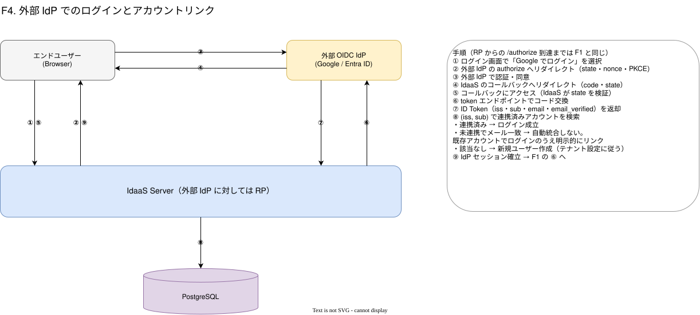

# F4. 外部 IdP でのログインとアカウントリンク

外部 OIDC IdP で認証し、IdaaS Server のアカウントに紐付けてログインする流れ。メールアドレスの一致だけでは自動統合しない。

---

← [前: F3](f3-client-credentials.md) ｜ [フロー一覧](../README.md#主要フロー) ｜ [次: F5](f5-logout.md) →
