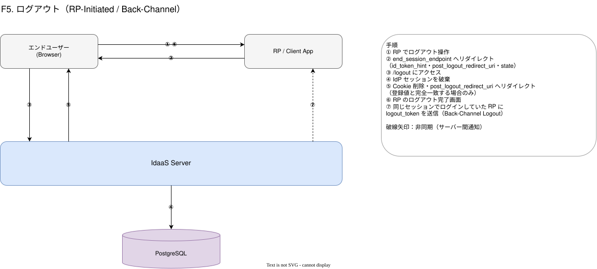

# F5. ログアウト（RP-Initiated / Back-Channel）

RP を起点に IdP セッションを破棄し、同じセッションでログインしていた RP にも通知する流れ。

---

← [前: F4](f4-external-idp-login.md) ｜ [フロー一覧](../README.md#主要フロー) ｜ [次: F6](f6-password-reset.md) →
