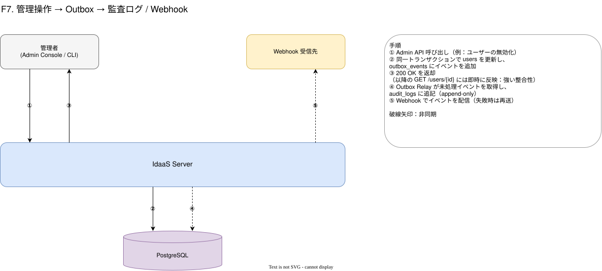

# F7. 管理操作 → Outbox → 監査ログ / Webhook

管理操作の状態変更とイベントを同一トランザクションで書き込み、非同期に監査ログ追記と Webhook 配信を行う流れ。

---

← [前: F6](f6-password-reset.md) ｜ [フロー一覧](../README.md#主要フロー) ｜ [次: F8](f8-key-rotation.md) →
